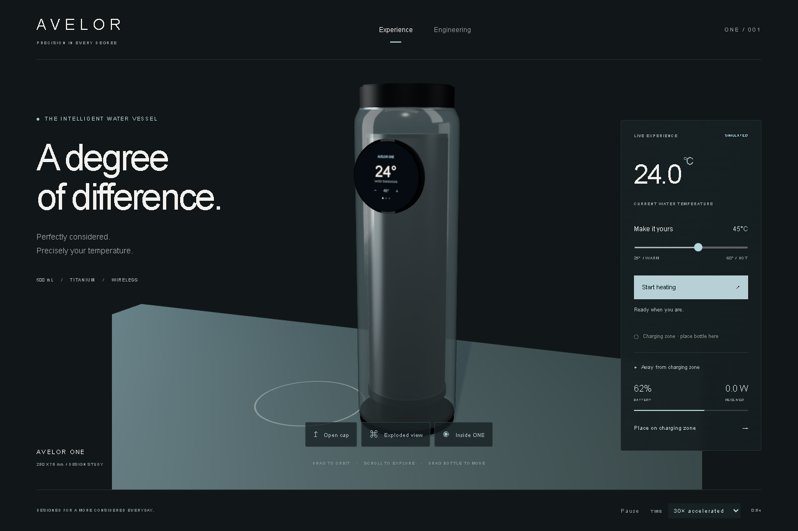
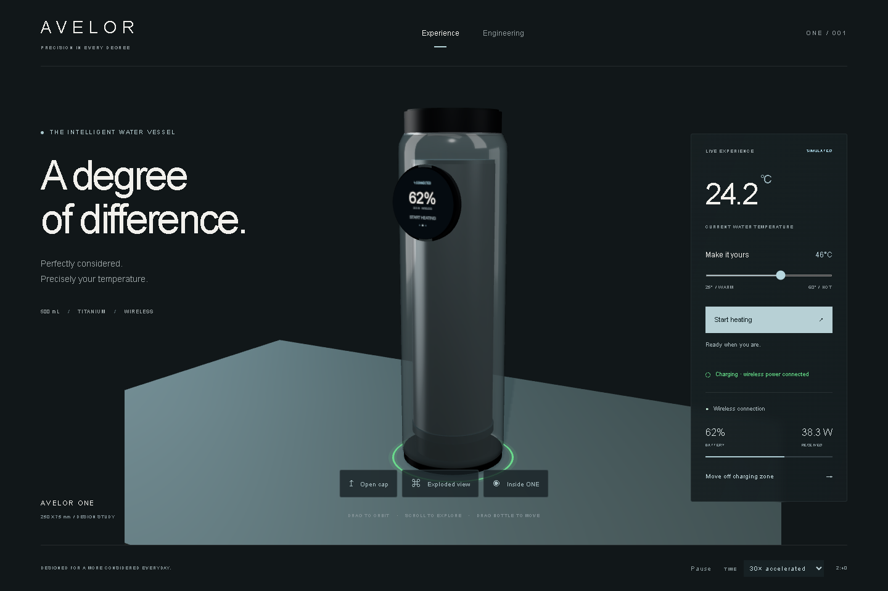
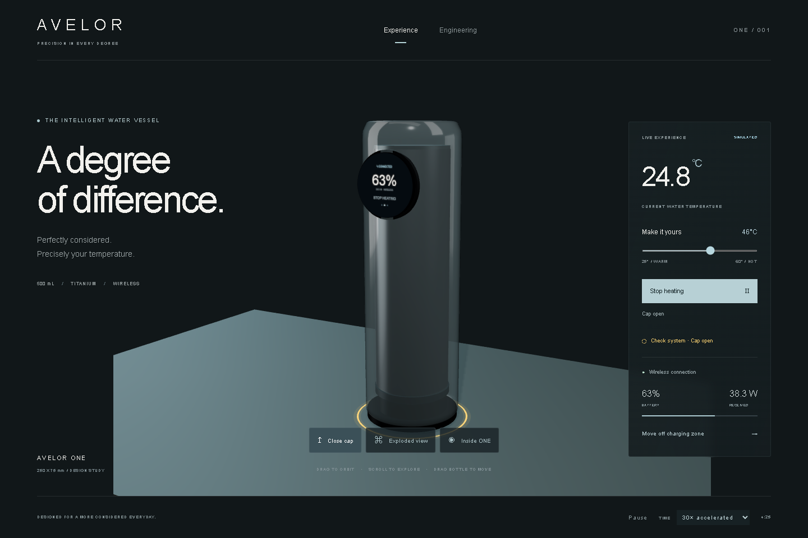
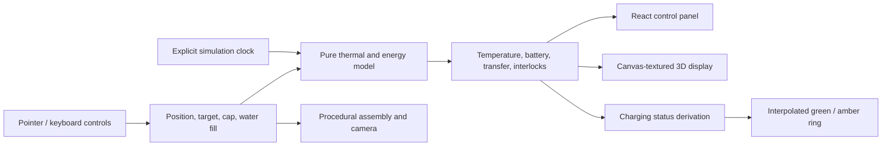

<div align="center">

# AVELOR ONE

### Temperature, considered.

A 500 mL smart water vessel explored through industrial design, interactive 3D and an inspectable energy model.

[Explore the live experience](https://ali9235.github.io/avelor-one/) · [Engineering analysis](docs/ENGINEERING.md) · [Validation](docs/VALIDATION.md)



**Project direction and ownership: [alivex / ali9235](https://github.com/ali9235)**

</div>

## The problem

A drink left on a desk gradually loses heat. Reheating interrupts the task, while a small battery places a hard limit on how much heat a portable vessel can supply. AVELOR ONE investigates a simple interaction: set a temperature, place the bottle on a marked surface, and understand its energy state at a glance.

The project brings product form, power delivery and thermal behaviour into the same interactive model. Moving the vessel changes wireless coupling; that changes available power, which changes battery flow and heating. The interface exposes these consequences instead of using a scripted temperature animation.

**Current scope:** a working browser application and engineering simulation. Physical hardware, manufacturing drawings and measured prototype performance are future work.

## Experience the system

| Interaction | Implemented behaviour |
| --- | --- |
| Move the vessel | Drag across the desk or use the placement button; transfer falls with offset and stops outside the zone. |
| Touch the circular display | Change the target, switch among three pages and start or stop heating using raycast touch coordinates. |
| Set a temperature | A hysteresis controller regulates the numerical water model between 25°C and 60°C. |
| Inspect construction | Animate the cap, separate the assembly and reveal the internal vessel and coil. |
| Read the charging edge | Green indicates charging or connected power; amber indicates an interlock or weak alignment. Colour changes ease gradually. |
| Inspect the model | Open Engineering for energy counters, assumptions, fill level, simulation speed and reduced motion. |

<table><tr><td width="50%"><br/><strong>Aligned / receiving power</strong></td><td width="50%"><br/><strong>Attention / cap-open interlock</strong></td></tr></table>

The adjacent text status communicates the same state as the colour. Reduced motion removes the gradual interpolation. A full battery is distinguished from a battery actively accepting charge. Inspection deliberately disconnects power and is not classified as a fault.

## System architecture



The numerical model has no dependency on React or Three.js. The renderer consumes state; it does not invent physics results. There is no application server or paid API in the runtime path.

## Engineering, in numbers

| Design input | Current assumption |
| --- | --- |
| Exterior envelope | Approximately 250 mm tall × 75 mm diameter |
| Display | Approximately 48 mm diameter / 1.9 inches |
| Nominal water load | 0.5 kg; the procedural inner cylinder is approximately 494 mL before headspace allowances |
| Heater | 35 W electrical, 90% modelled heat conversion |
| Battery | 18 Wh capacity; maximum modelled charging power 12 W |
| Desk transmitter | 60 W enabled input; position-dependent receiver efficiency |
| Ambient / heat loss | 22°C / 0.35 W/K |

These are editable model inputs, not measured specifications. The inner volume needs refinement to meet a practical 500 mL fill specification. See [equations, units and boundaries](docs/ENGINEERING.md).

## Quick start

Install Node.js 22.12+ or 24, and pnpm 11.25.0.

```sh
git clone https://github.com/ali9235/avelor-one.git
cd avelor-one
pnpm install --frozen-lockfile
pnpm dev --port 5190
```

Open `http://127.0.0.1:5190`. On Windows, `./Start-Avelor.ps1` also starts an already installed checkout. For production output, run `pnpm build`; serve `dist/` with a static host.

The public portfolio experience is hosted on [GitHub Pages](https://ali9235.github.io/avelor-one/). `pnpm run build:pages` sets Vite's asset base to `/avelor-one/`; the default build remains suitable for a domain root. The Pages workflow tests, builds and deploys updates pushed to `main`, following [GitHub's custom-workflow setup](https://docs.github.com/en/pages/getting-started-with-github-pages/using-custom-workflows-with-github-pages).

```sh
pnpm test
pnpm build
pnpm exec playwright install chromium
pnpm run test:browser
```

The browser check expects the development server on port 5190. It captures real screenshots and optionally records video with `AVELOR_RECORD=1`. An existing Chromium binary can be selected with `AVELOR_BROWSER_EXECUTABLE`. See [validation instructions](docs/VALIDATION.md).

## Engineering decisions

- **A lumped thermal model:** makes energy accounting explicit and testable. It assumes well-mixed water and does not predict local hot spots or surface temperatures.
- **Procedural geometry:** keeps the design inspectable and parameterised in source. The result is a visualization model, not tolerance-controlled CAD.
- **A bounded coupling curve:** makes misalignment visible while avoiding a claim of electromagnetic field simulation or Qi compliance.
- **A raycast display:** keeps its controls attached to the bottle in 3D; equivalent keyboard controls remain in the panel.
- **State-driven light:** communicates actual simulation state. No random fault animation or timer-based pretend charging.
- **Independent model and renderer:** enables automated energy tests without a GPU, browser or backend.

The [engineering analysis](docs/ENGINEERING.md) explains the trade-offs and the [development notes](docs/DEVELOPMENT.md) record observed implementation problems and their fixes.

## Tests and evidence

The current local suite contains **17 passing tests** for the thermal model, charging and indicator state. TypeScript checking and the production build passed. Browser checks cover direct display interaction, dock/undock, cap interlocks, green/amber states, assembly views and mobile overflow.

[Real interaction recording](media/interaction-demo.webm) · [Exploded assembly](media/exploded.png) · [Full test record and limitations](docs/VALIDATION.md)

Performance is not represented as a guaranteed frame rate. Safari on a physical iPhone has not been validated. The build currently warns about the size of the Three.js application bundle.

## Source map

```text
src/
  main.tsx           Interaction state, controls and simulation clock
  Scene.tsx          Bottle, display, desk, lighting and camera
  physics.ts         Thermal model, energy budget and interlocks
  charging.ts        Charging / attention state derivation
  *.test.ts          Deterministic numerical and state tests
docs/                Engineering, validation and development notes
media/               Real application captures and recording
tools/               Repeatable browser checks
```

## Limitations and next steps

The current model excludes evaporation, boiling, temperature stratification, vessel thermal mass, battery ageing and battery thermal dynamics. A physical product also needs seals, insulation, food-contact material selection, independent thermal protection and validated wireless electronics. These constraints are discussed in the engineering document rather than presented as completed hardware work.

Next milestones: validated mechanical dimensions; measured coupling and heat-loss data; a calibrated model; battery thermal protection; hardware-in-the-loop tests; physical touch-device testing; loading and rendering profiling. See [the roadmap](docs/DEVELOPMENT.md#roadmap).

## Ownership, security and reuse

Maintained under **[ali9235](https://github.com/ali9235)**. Project direction and design brief are owner-led; implementation and documentation include AI assistance. Claims are tied to source, tests or actual captures.

The application processes interaction state in the browser. It does not request camera, microphone, location or account credentials. See [security and privacy](SECURITY.md). Contributions should include a reproducible change and relevant validation; see [CONTRIBUTING.md](CONTRIBUTING.md).

No open-source licence has been selected. Public visibility does not grant unrestricted redistribution or commercial use. Contact the owner for permission.
